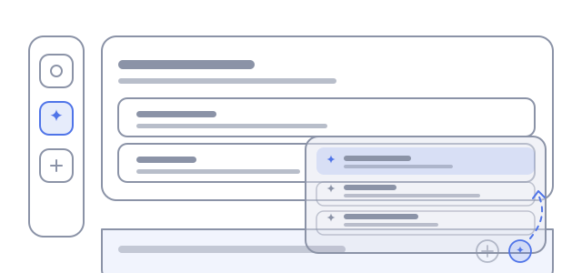

# dsh-skill-panel

[](https://github.com/deepseek-ai/deepseek-harness)
[](LICENSE)

English | [中文](README.zh.md)

A [DeepSeek Harness](https://github.com/deepseek-ai/deepseek-harness) plugin that puts the installed **skills** where you look for them: a Skills page in the left panel, and a skill picker in the composer next to the plus button.



## What it adds

**Left rail → Skills.** A sparkle entry sits beside the Plugins and Schedules entries. The page lists every skill the open conversation can invoke:

- `/name`, the skill's description, and its extra routing guidance;
- a **You only** tag for `disable-model-invocation` skills — the ones the model never sees, which you can only start from here or by typing `/name`;
- a filter field that matches name, description, or guidance, and a refresh button;
- an eye button per row that opens the skill's `SKILL.md` in the right sidebar.

**Composer → skill picker.** A 28px sparkle button sits in the composer tool row, right of the plus button and the permission controls. Pressing it opens the skill list; picking one inserts `/name ` at the start of the draft, exactly as if you had typed it there. The button reports the list's state (`aria-expanded`), is disabled while a message is sending, and hands focus back to the editor when you activate it from the keyboard.

Nothing is sent for you: the picker only edits the draft, and the host loads the skill when you submit, the same way a hand-typed `/name` resolves.

## Install

This package is a DSH **bundle** (`dsh.bundle.patch`), so it shows up in **Plugins** like any other plugin.

**From GitHub.** In a DSH session, ask the agent to install the bundle from `github:G820G/dsh-skill-panel`; its `plugin_manager` tool accepts a Git spec. Pin a commit (`github:G820G/dsh-skill-panel#<40-character sha>`) to keep the install reproducible and updatable.

**From a local checkout.** Clone the repository, then use **Plugins → Add plugin** and choose the directory. A directory install links the checkout, so later edits take effect without reinstalling.

```sh
git clone https://github.com/G820G/dsh-skill-panel.git
```

**Requirements.** DeepSeek Harness `>=0.2.2-rc.3 <0.3.0` (declared as `engines.dsh`), with the Web GUI. There is no build step and no runtime dependency: the browser half is plain JavaScript loaded by the Web client.

## Compatibility

| DSH release | Status |
|---|---|
| `0.2.2-rc.3` | compatible — this is the release it was built and verified against |

The plugin uses public extension points only (`sidebar.panellist`, the `main` panel, `conversation.input.left`, the `skills/list` Remote, and the input-trigger launcher). A future DSH release that renames one of those would degrade a single surface rather than break the app; `dsh.compatibility.dshReleases` records what was actually checked.

## How it works

- The list is the host's own catalog: `skills/list` for the session shown in the main view, so it matches the `/` menu exactly and never drifts from the installed skills.
- The picker does not implement its own list. It opens the shipped `/` menu restricted to the shipped `skill` source through the input-trigger launcher, so a pick travels the same pipeline as a typed `/name` — literal text in, no private insertion path.
- The built-in plus button is bound to the menu's *command* group, which a plugin cannot extend, so the picker is a sibling control in the same tool row rather than a row inside that menu.
- `remote.skills` is a guarded Client Remote namespace: the plugin declares `remote` and `remote.skills` in its `inject` list and captures the namespace while it applies, the same way the shipped skill UI does.

## Limitations

- The catalog is the **open session's** agent composition, so a conversation must be open; with no session the page explains how to get one.
- Skills are listed and insertable whether or not their provider supplies a file path, but only path-bearing skills get a preview button.
- The panel is read-only: it does not install, disable, or reorder skills — that stays with the plugin/skill providers.
- The picker is a launcher, not a replacement for the composer: it inserts text at the start of the message because the host only loads a leading `/name`.

## Repository layout

```
client.js          the whole browser half (React.createElement, no build)
index.js           host half (empty: every surface is client-side)
cordis.patch.yml   the bundle patch that inserts the plugin row
locale/            plugin-manager title, description, detail document path
docs/              detail document and its illustration
icon.svg           plugin icon
```

## Development

There is no bundler. Edit `client.js`, keep it valid plain JavaScript, and the running Web client picks the new module up through client-plugin HMR (refresh the page if a change ever looks stale):

```sh
node --check client.js
```

A linked directory install (see **Install**) is the fastest loop: save the file, look at the panel.

## License

[MIT](LICENSE)
